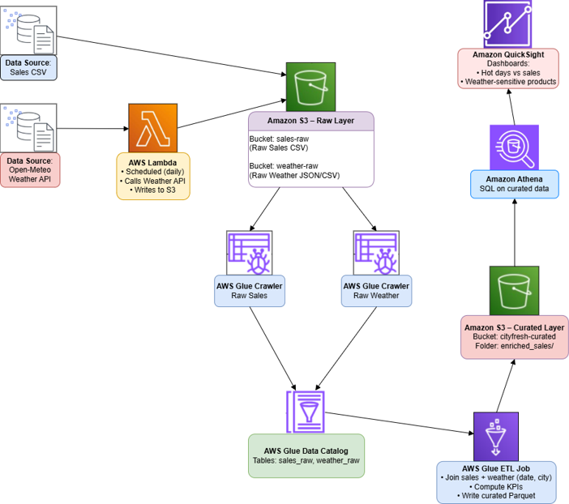

# Stakeholders & Business Value

## Target stakeholders
1. **Retail Operations Managers** – need better inventory and staffing decisions.
2. **Merchandising / Category Managers** – optimize product assortment and promotions based on demand drivers.
3. **Supply Chain / Inventory Planners** – reduce stockouts and overstocking by anticipating weather-driven demand swings.
4. **Data / Analytics Team** – provides a reusable data foundation for forecasting and dashboards.

## Business value delivered
This pipeline enables weather-aware retail analytics that can:
- Improve **inventory efficiency** by anticipating demand shifts caused by temperature and precipitation.
- Support **promotion planning** (e.g., cold drink promotions on hot periods).
- Reduce **waste and stockouts**, improving customer satisfaction and margin.
- Provide a scalable pattern for integrating external contextual data sources into retail KPIs.

# Pipeline Architecture

## Architecture diagram

## High-level flow
1. **Sales data ingestion:** Synthetic sales CSV is stored in Amazon S3 (raw layer).
2. **Weather ingestion:** AWS Lambda retrieves daily weather metrics from the Open-Meteo API for each store location and stores results in S3 (raw layer).
3. **Cataloging:** AWS Glue Crawlers register raw datasets as tables in the Glue Data Catalog.
4. **Transformation:** AWS Glue ETL job joins sales and weather, applies cleaning/typing, and writes curated analytics-ready data back to S3 in Parquet format.
5. **Analytics:** Amazon Athena queries the curated dataset to calculate KPIs and generate insights.

## Cost overview (estimate)
Based on expected student-scale volumes:
- S3 storage: small (MB–GB scale)
- Lambda ingestion: low frequency, within free-tier range
- Glue crawlers + ETL: a few runs per month
- Athena queries: small scans due to Parquet format

Estimated total monthly cost: **~$1.5–$2.0** (order-of-magnitude estimate).

## Scheduling consideration
In a production deployment, the weather ingestion Lambda would be triggered daily using Amazon EventBridge.  
In the AWS Academy sandbox environment, ingestion is demonstrated via manual execution and historical backfill, which validates the end-to-end pipeline logic.

AWS Glue Crawlers catalog both raw datasets into the Glue Data Catalog, which is then used by Glue ETL jobs and Athena.

