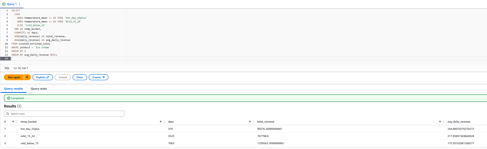
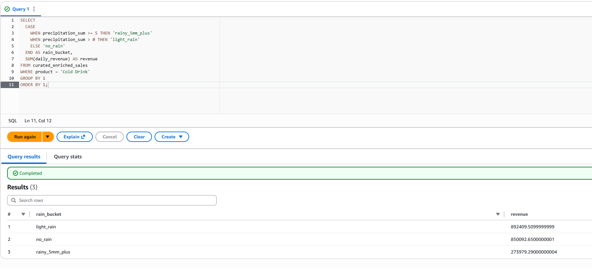

# KPIs

This project contributes to measuring and improving the following KPIs:

1. **Weather-Adjusted Demand Index**
   - Measures how sales volume deviates from baseline under specific weather conditions (e.g., hot days vs cold days).
   - Business use: demand planning and forecasting calibration.

2. **Stockout Risk Proxy (Demand Spike Indicator)**
   - Identifies days where weather conditions historically correlate with unusually high demand for certain categories.
   - Business use: proactive replenishment and staffing decisions.

3. **Promotion Uplift vs Weather Context**
   - Compares sales uplift during promotion days under different weather conditions.
   - Business use: schedule promotions when they are most effective.

(These KPIs will be computed using Athena SQL on the curated dataset after joining sales and weather.)

# KPIs

This document describes the key business metrics derived from the curated sales and weather dataset using Amazon Athena.

---

## KPI 1 — Hot-Day Uplift (Ice Cream)

**Definition:**  
Ice Cream revenue segmented by temperature bucket (cold, mild, hot).

**Logic:**  
Daily Ice Cream revenue is aggregated and grouped by average daily temperature ranges.

**Business value:**  
Supports inventory planning, pricing strategy, and promotional decisions during warm and hot periods when demand increases.

While cold days generate the highest total ice cream revenue due to their higher frequency across the year, hot days exhibit the highest average daily revenue, indicating a clear temperature-driven uplift in demand.
This distinction highlights the importance of normalization when analyzing weather-sensitive sales effects.

---

## KPI 2 — Rain Sensitivity (Cold Drinks)

**Definition:**  
Cold Drink revenue segmented by precipitation level (no rain, light rain, heavy rain).

**Logic:**  
Revenue is grouped based on daily precipitation amounts to observe demand changes under different weather conditions.

**Business value:**  
Helps retailers adapt product mix and staffing during rainy days and anticipate lower or shifted demand.

---

## KPI 3 — Weather-Sensitive Revenue Share

**Definition:**  
Percentage of total revenue generated by weather-sensitive products (Ice Cream and Cold Drinks).

**Logic:**  
Revenue from weather-sensitive products is compared to overall revenue to calculate proportional impact.

**Business value:**  
Quantifies exposure to weather variability and supports risk-aware planning and forecasting.
