# Implementation

## 1) Synthetic Sales Dataset Generation

### Why synthetic data?
Real retail sales data is often proprietary. To demonstrate a realistic pipeline without exposing sensitive information, I generated a synthetic dataset that simulates daily retail transactions across multiple stores and products.

### Time range and granularity
- Date range: **2021-01-01 to 2025-12-31**
- Granularity: **daily sales per store per product**
- File: `data/sales_synthetic_2021_2025.csv` (~4.6 MB)

### Schema
Columns:
- `date` (YYYY-MM-DD)
- `store`, `country`
- `lat`, `lon` (store coordinates)
- `product`
- `quantity_sold`
- `price`

### Realism assumptions embedded in the generator
The generator encodes business-realistic behavior:
- **Seasonality:** summer boosts cold products (ice cream, cold drinks), winter boosts hot products (coffee, tea).
- **Store size effects:** larger cities have higher baseline demand.
- **Weekend uplift:** higher traffic on weekends.
- **Promotions:** random promo events with demand uplift (more likely in summer and Nov–Dec).
- **Price dynamics:** small inflation trend over time plus minor noise.

These assumptions make downstream KPIs and insights interpretable, rather than purely random.

### Synthetic Data Generator Code

The synthetic sales dataset was generated using a custom Python script that encodes business-relevant assumptions such as seasonality, store size effects, promotions, and price inflation.

The generator script is included in the repository for transparency and reproducibility:
- `data_generation/generate_sales.py`

The script was executed once to produce the input dataset used in the pipeline.

## 2) Weather Data Integration Strategy (Join Logic)

Sales data and weather data originate from independent systems and have different schemas. Integration is achieved by aligning records on shared temporal and spatial dimensions:

**Join keys**
- `date` (daily time dimension)
- `lat`, `lon` (store location)

Conceptually:
- `sales.date = weather.date`
- `sales.lat = weather.lat`
- `sales.lon = weather.lon`

This reflects common data warehousing practice where contextual data (weather) is joined to granular fact data (sales).

## 3) Raw Data Storage (Amazon S3)

The data lake is implemented using Amazon S3 with a clear separation between raw and curated data layers.

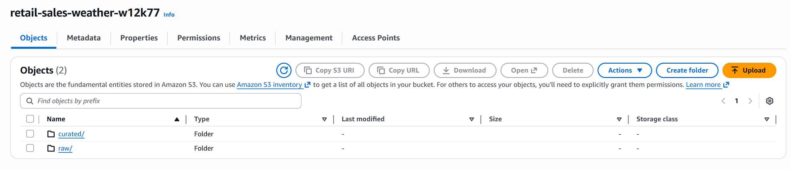

### Bucket structure
- `raw/sales/` – internal sales CSV data
- `raw/weather/` – external weather data ingested via API
- `curated/` – transformed, analytics-ready datasets

The synthetic sales dataset covering 2021–2025 was uploaded to the raw sales layer and serves as the internal data source for the pipeline.

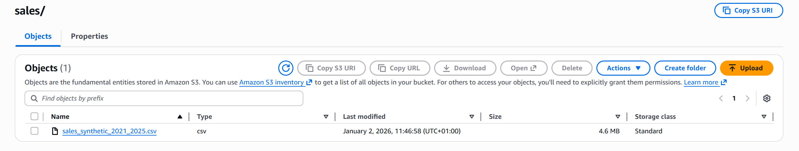

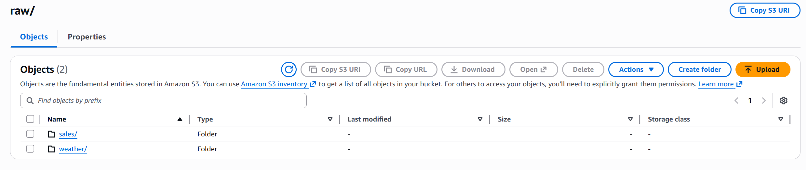

## 4) Weather Ingestion (AWS Lambda + Open-Meteo)

Weather data is ingested from the Open-Meteo API using an AWS Lambda function (`weather_ingest_openmeteo`).  
The function retrieves daily weather metrics (mean temperature and precipitation sum) for each store location and writes the results into the S3 raw layer.

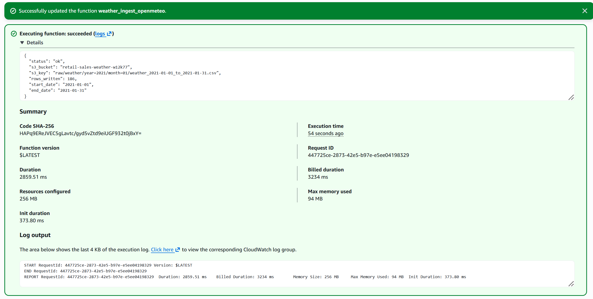
The Lambda function was manually executed to validate connectivity to the Open-Meteo API and correct ingestion logic. The successful response confirms that daily weather data is retrieved and processed correctly.

### Output format and storage
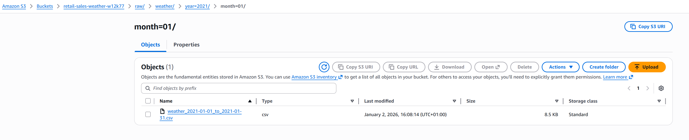
Each Lambda execution writes a weather CSV file to the raw weather folder in S3 following a time-partitioned directory structure.
- Output: CSV
- S3 path pattern:
  - `raw/weather/year=YYYY/month=MM/weather_<start>_to_<end>.csv`

### Backfill strategy
To avoid large API requests and to keep the process reliable, historical ingestion is performed in monthly chunks. This mirrors real-world backfill practices and reduces the risk of timeouts.

### Historical backfill (2021–2025)

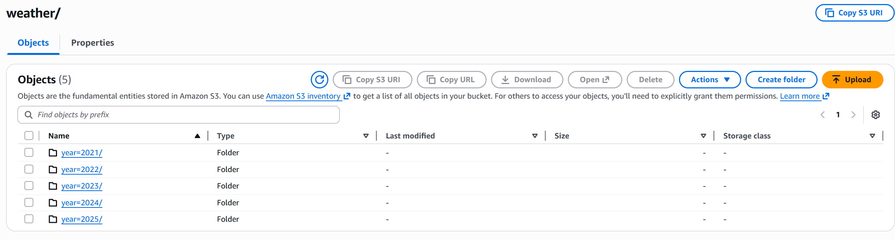

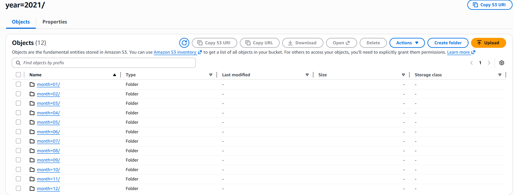

Historical weather data was ingested in monthly chunks (2021-01 to 2025-12) to avoid large API requests and reduce timeout/rate-limit risk. Each run writes a month-partitioned CSV file to:

`raw/weather/year=YYYY/month=MM/weather_<start>_to_<end>.csv`

This approach is consistent with real-world backfill patterns and supports efficient partition pruning in downstream analytics.

## 5) Data Cataloging (AWS Glue Crawlers)

AWS Glue Crawlers were used to automatically infer schemas and register the raw datasets as tables in the Glue Data Catalog.

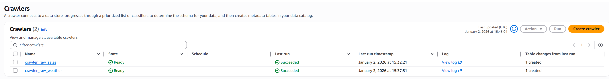
Both crawlers completed successfully, confirming that AWS Glue was able to discover the raw datasets stored in Amazon S3 and register them in the Glue Data Catalog.

- `crawler_raw_sales` crawls `s3://<bucket>/raw/sales/`
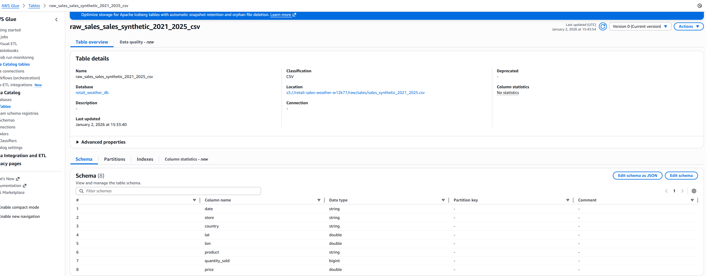
The crawler inferred the sales table schema, including data types like dates, products, quantities, and prices, enabling downstream SQL-based analytics.

- `crawler_raw_weather` crawls `s3://<bucket>/raw/weather/`
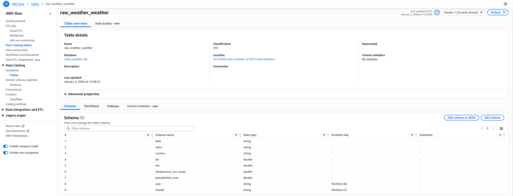
The weather crawler registered daily temperature and precipitation metrics, standardizing external API data into a queryable tabular format.

Both crawlers write tables into the Glue database `retail_weather_db`, enabling downstream querying and ETL development.

## 6) Data Transformation (AWS Glue ETL)

An AWS Glue ETL job joins raw sales and raw weather data on date, store, and country.
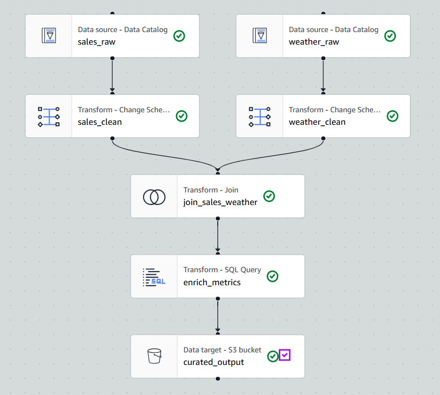

The Glue ETL job visually defines the transformation pipeline, including schema normalization, dataset joins, derived metric computation, and output materialization.

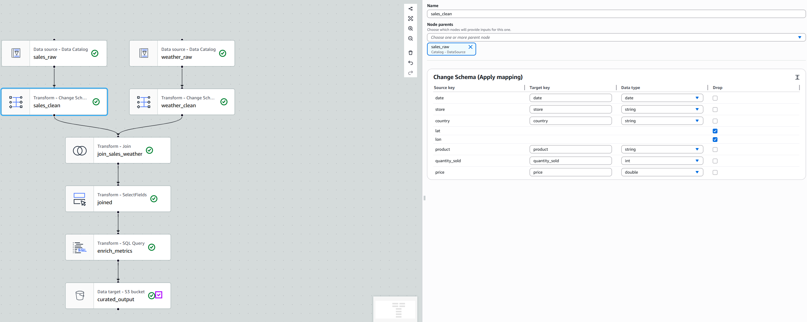

This step standardizes the raw weather and raw sales dataset by selecting relevant fields, renaming columns, and enforcing consistent data types to ensure reliable downstream joins and analytics.

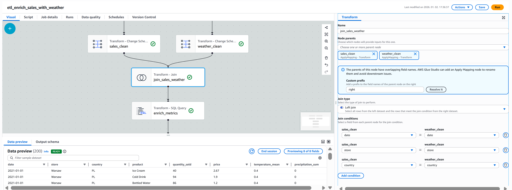

Sales and weather datasets are joined on shared temporal and spatial dimensions.

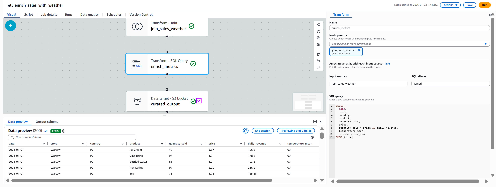

The job standardizes schemas, computes daily revenue, and writes an analytics-ready dataset in Parquet format to the curated S3 layer.

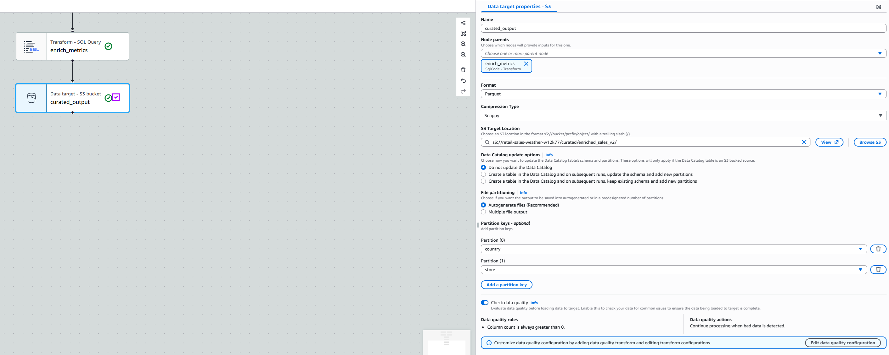

The curated dataset contains enriched sales records with associated daily weather conditions.

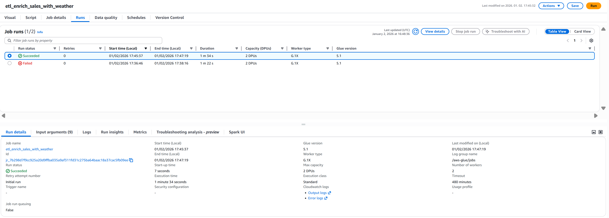

The successful job run confirms that the end-to-end transformation pipeline executed correctly and produced curated output without errors. The first try resulted a failed job run, but after addressing some minor issues the second run was successful.

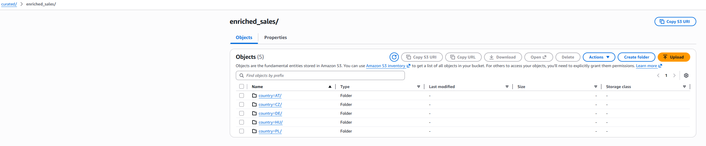

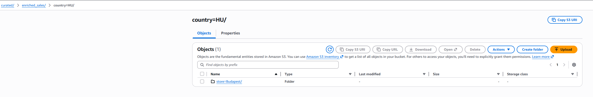

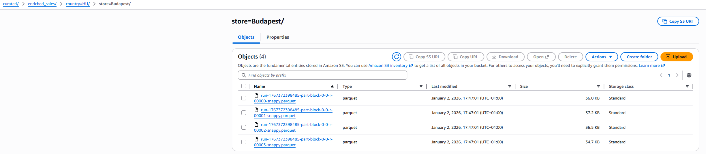

## 7) Analytics Layer (Amazon Athena)

.png)

A sanity check query confirms that the curated Parquet dataset is accessible and queryable using Amazon Athena.

Amazon Athena was used as the analytics engine to query the curated Parquet dataset stored in Amazon S3.

An Athena database named retail_weather_athena is created to logically group all analytics tables derived from the curated data layer.

An external table was created over the curated output, enabling serverless SQL-based analysis without additional infrastructure.
The primary external table, curated_enriched_sales, points to the Parquet dataset stored in the curated S3 layer and serves as the foundation for all KPI queries.

Athena queries were executed to:
- Validate the availability and structure of the curated dataset
- Compute business KPIs linking sales performance to weather conditions
- Demonstrate analytical usability of the end-to-end data pipeline

This analytics layer completes the pipeline by enabling ad-hoc exploration and business insight generation directly from the curated data.
