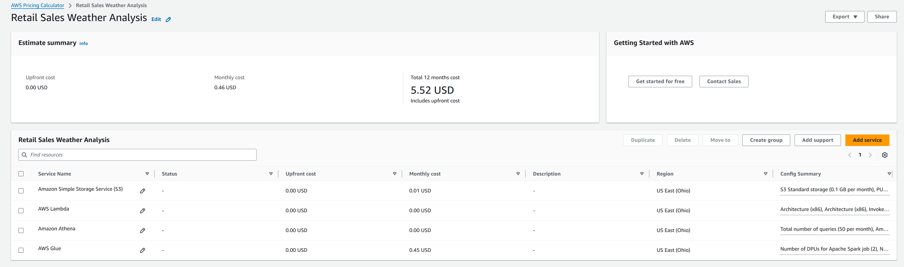
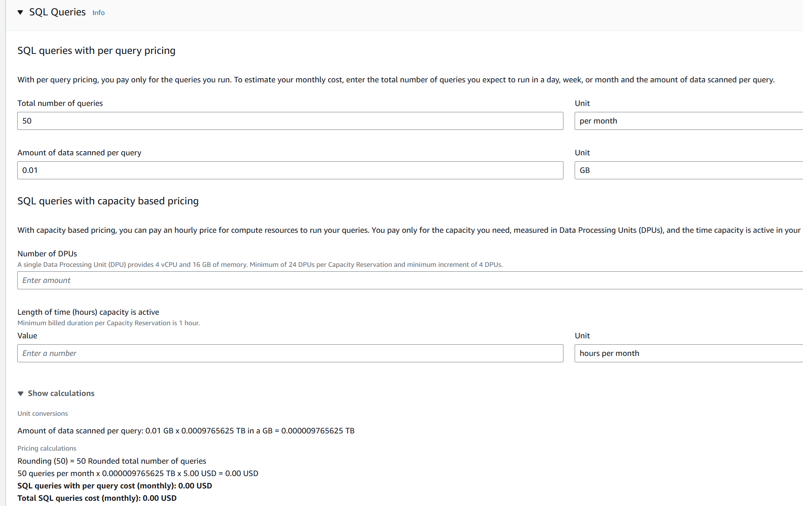
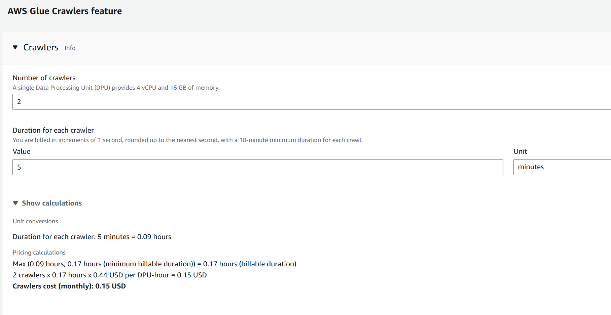
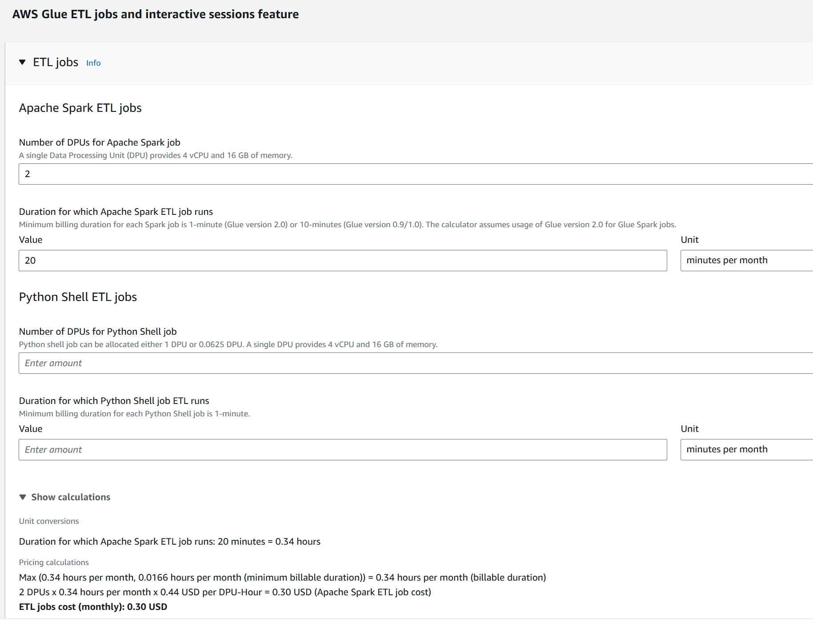
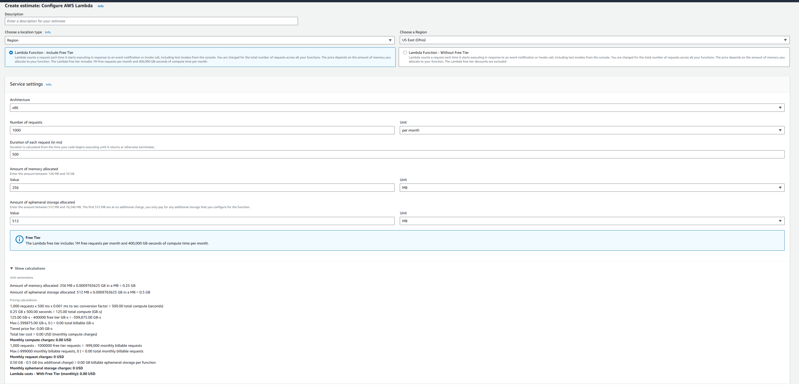
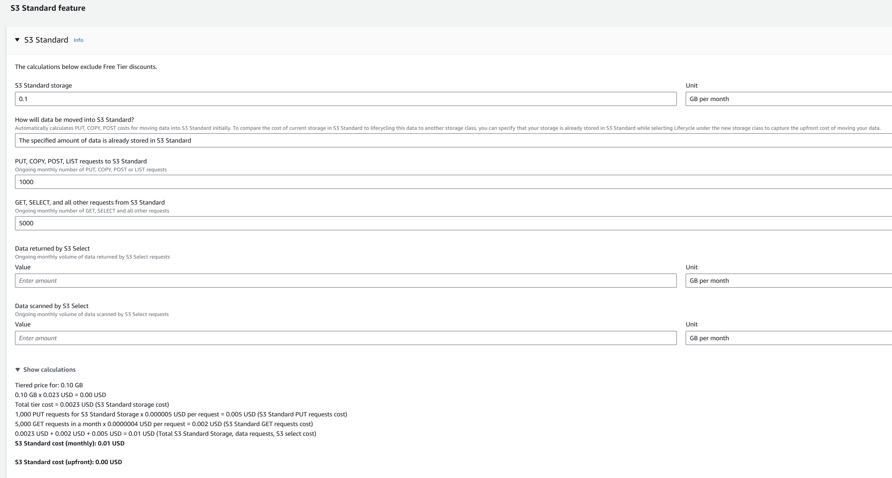

## Cost Estimation (AWS Pricing Calculator)

The operational cost of the **Retail Sales Weather Analysis** pipeline was estimated using the **AWS Pricing Calculator**.  
The calculation reflects a **low-volume, serverless analytics workload**, consistent with the size of the generated synthetic datasets and the educational scope of the project.

The estimate covers all AWS services used in the architecture:
- Amazon S3  
- AWS Glue (Crawlers and ETL Jobs)  
- Amazon Athena  
- AWS Lambda  

---

### Overall Cost Summary

**Estimated costs:**
- **Monthly cost:** ~0.46 USD  
- **Annual cost (12 months):** ~5.52 USD  
- **Upfront cost:** 0 USD  

This confirms that the proposed architecture is **highly cost-efficient** while still supporting scalable analytics.

---

### Amazon Athena Cost Calculation

Amazon Athena was configured using **per-query pricing**, which is appropriate for ad-hoc analytical workloads.

**Assumptions:**
- 50 SQL queries per month  
- ~0.01 GB data scanned per query  

Due to the small data volume and limited query frequency, the resulting Athena cost is **effectively negligible (≈ 0 USD per month)**.

---

### AWS Glue Crawlers Cost Calculation

AWS Glue Crawlers are used to infer schemas and update the Glue Data Catalog.

**Assumptions:**
- 2 crawlers  
- ~5 minutes runtime per crawl  
- Minimum billable duration applied  

**Estimated monthly cost:** ~0.15 USD

---

### AWS Glue ETL Jobs Cost Calculation

AWS Glue ETL jobs (Apache Spark) are used to transform and enrich the sales and weather datasets.

**Assumptions:**
- 2 DPUs  
- ~20 minutes total runtime per month  

**Estimated monthly cost:** ~0.30 USD

This reflects lightweight ETL logic applied to small, structured datasets.

---

### AWS Lambda Cost Calculation

AWS Lambda is used for lightweight orchestration tasks (e.g. triggering ingestion or ETL jobs).

**Assumptions:**
- 1,000 invocations per month  
- 256 MB memory  
- ~500 ms execution time  

All usage falls within the **AWS Free Tier**, resulting in **0 USD monthly cost**.

---

### Amazon S3 Cost Calculation

Amazon S3 is used to store raw and processed datasets.

**Assumptions:**
- ~0.1 GB stored data  
- ~1,000 PUT requests per month  
- ~5,000 GET requests per month  

**Estimated monthly cost:** ~0.01 USD

---

### Cost Efficiency and Business Alignment

The serverless design ensures that:
- Costs scale **only with actual usage**
- There are **no always-on infrastructure costs**
- The solution remains economically viable even for small-scale analytics use cases  

This directly supports the project’s business goal of enabling **data-driven insights at minimal operational cost**.

---

### Reproducibility Notes

All cost estimates were produced using the AWS Pricing Calculator.  
The calculation screenshots are stored in the repository under:

